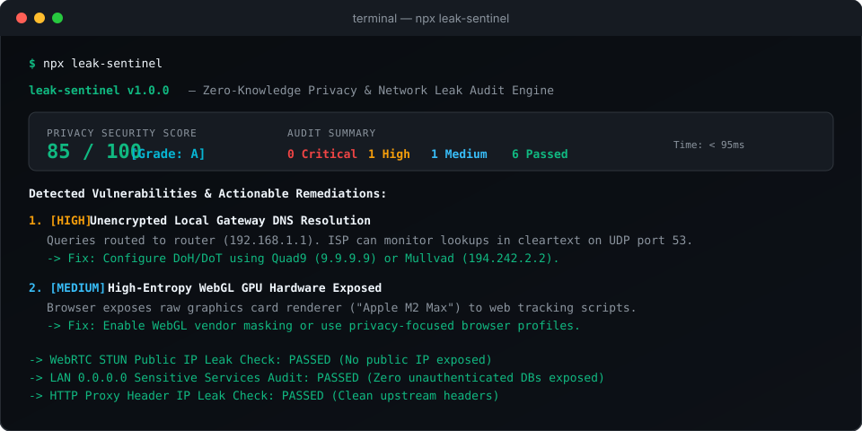

# leak-sentinel

[](https://github.com/dalsc-dev/leak-sentinel/actions)
[](https://opensource.org/licenses/MIT)
[](https://nodejs.org/)
[](package.json)

> **Zero-knowledge privacy and network leak audit engine for developers, systems engineers, and VPN users.**

<p align="center">
  
</p>

`leak-sentinel` is a standalone command-line diagnostic tool and local web inspection service that audits workstations, active VPN tunnels, and network adapters for traffic leakage, unencrypted name resolution bypasses, WebRTC host exposures, and accidental `0.0.0.0` non-loopback developer service bindings.

---

## Table of Contents

- [Problem Statement and Threat Model](#problem-statement-and-threat-model)
- [Audit Vectors and Heuristics](#audit-vectors-and-heuristics)
  - [1. DNS Resolver and Split-Tunnel Auditing](#1-dns-resolver-and-split-tunnel-auditing)
  - [2. WebRTC STUN and IPv6 Bypass Detection](#2-webrtc-stun-and-ipv6-bypass-detection)
  - [3. LAN and Localhost Service Exposure Guard](#3-lan-and-localhost-service-exposure-guard)
  - [4. HTTP Proxy Header and Client Hint Leakage](#4-http-proxy-header-and-client-hint-leakage)
  - [5. Hardware Fingerprinting and Entropy Analysis](#5-hardware-fingerprinting-and-entropy-analysis)
- [Quickstart](#quickstart)
- [CLI Reference](#cli-reference)
- [Programmatic Node.js API](#programmatic-nodejs-api)
- [CI/CD Pipeline Integration](#cicd-pipeline-integration)
- [Local Web Dashboard Architecture](#local-web-dashboard-architecture)
- [Comparison Matrix](#comparison-matrix)
- [Performance and Overhead](#performance-and-overhead)
- [Security Model and Defensive Policy](#security-model-and-defensive-policy)
- [License](#license)

---

## Problem Statement and Threat Model

Engineers and privacy-conscious users regularly operate under false security assumptions regarding their network privacy:

1. **Split-Tunnel DNS Leaks (SMHNR)**: Even when a commercial or enterprise VPN tunnel is active, contemporary operating systems (notably Windows Smart Multi-Homed Name Resolution and macOS resolver dispatchers) frequently transmit DNS lookups concurrently over physical network adapters, exposing destination hostnames to local ISPs in cleartext.
2. **WebRTC STUN / ICE Bypass**: Web browsers implement Session Traversal Utilities for NAT (STUN) as part of WebRTC ICE candidate gathering. Malicious or tracking scripts can initiate silent STUN queries that reflect the client's true public ISP IP address and IPv6 address, bypassing operating-system-level HTTP/SOCKS proxies.
3. **Inadvertent 0.0.0.0 Service Exposure**: Modern local developer tooling—such as Ollama (port 11434), Redis (port 6379), Docker daemon sockets (port 2375), and relational database engines—often bind to `0.0.0.0` by default. When connected to public, conference, or office Wi-Fi networks, these unauthenticated endpoints become reachable by any host on the same local subnet.
4. **Commercial Leak Test Limitations**: Traditional online leak tests are third-party software-as-a-service sites heavily monetized with affiliate advertising. They do not run locally, cannot inspect local listening ports, and collect metadata on tested IP addresses.

`leak-sentinel` addresses these vectors locally, deterministically, and with zero external dependencies.

---

## Audit Vectors and Heuristics

### 1. DNS Resolver and Split-Tunnel Auditing
- **Mechanism**: Inspects system-configured nameservers using native OS resolution primitives (`node:dns`).
- **Detection Criteria**:
  - Flags plaintext UDP port 53 transmission without cryptographic encapsulation (DoH/DoT).
  - Identifies routing through local gateway routers (`192.168.x.x`, `10.x.x.x`, `172.16.x.x`) where local ISP upstream servers capture lookups.
  - Detects split-tunnel multi-homing when both private gateway resolvers and public/VPN resolvers are simultaneously assigned.
- **Reference Standards**: RFC 1035 (Domain Names), RFC 8484 (DNS Queries over HTTPS).
- **Remediation**: Reconfigure system resolvers to dedicated zero-log encrypted endpoints (e.g., Quad9 `9.9.9.9`, Mullvad `194.242.2.2`) and enforce exclusive tunneling.

### 2. WebRTC STUN and IPv6 Bypass Detection
- **Mechanism**: Parses Interactive Connectivity Establishment (ICE) SDP attributes (`candidate:...`).
- **Detection Criteria**:
  - `typ srflx`: Server reflexive candidates generated by external STUN queries that reveal true ISP public IPv4 addresses behind NAT.
  - Globally routable IPv6 candidates (`2000::/3`) leaking when a VPN only routes IPv4 traffic.
  - `typ host`: Private RFC 1918 candidates revealing internal LAN subnet configuration.
- **Reference Standards**: RFC 8445 (ICE), RFC 8866 (SDP).
- **Remediation**: Enforce mDNS candidate masking (`.local` suffixes) or disable browser `media.peerconnection` interfaces.

### 3. LAN and Localhost Service Exposure Guard
- **Mechanism**: Enumerate listening network sockets and active physical interfaces (`node:os`).
- **Detection Criteria**: Identifies non-loopback bindings (`0.0.0.0`, `::`) on known sensitive services:
  - Port `11434`: Ollama HTTP API (unauthenticated model inference and file access).
  - Port `2375`: Docker daemon (unauthenticated root-equivalent host container execution).
  - Port `6379`: Redis (in-memory data store frequently run without authentication).
  - Ports `5432`, `3306`, `27017`: PostgreSQL, MySQL, MongoDB database listeners.
- **Remediation**: Rebind services explicitly to loopback (`127.0.0.1` or `::1`). For container runtimes, pass `-p 127.0.0.1:<port>:<port>`.

### 4. HTTP Proxy Header and Client Hint Leakage
- **Mechanism**: Analyzes ingress and outbound HTTP request header dictionaries.
- **Detection Criteria**:
  - Upstream IP disclosures: `X-Forwarded-For`, `Client-IP`, `X-Real-IP`, `Via`, `CF-Connecting-IP`.
  - High-entropy User-Agent Client Hints: `Sec-CH-UA-Model`, `Sec-CH-UA-Platform-Version`.
  - Absence of Global Privacy Control signal (`Sec-GPC: 1`).
- **Reference Standards**: RFC 7239 (Forwarded HTTP Extension).
- **Remediation**: Strip forwarding headers at gateway reverse proxies and enable Global Privacy Control.

### 5. Hardware Fingerprinting and Entropy Analysis
- **Mechanism**: Measures browser-exposed device attributes.
- **Detection Criteria**:
  - Unmasked WebGL hardware vendor and renderer strings (e.g., exposing raw GPU model identifiers).
  - Deterministic Canvas 2D image hashing without pixel noise injection.
  - Outlier system font counts exceeding 80 installed typefaces.
- **Remediation**: Enable canvas jitter and GPU vendor masking in browser security settings.

---

## Quickstart

Run an immediate one-line audit:

```bash
npx leak-sentinel
```

Launch the interactive dark-mode web dashboard:

```bash
npx leak-sentinel --web
```

Run in strict CI/CD gatekeeper mode:

```bash
npx leak-sentinel --fail-on-leak --json
```

---

## CLI Reference

```text
Usage:
  $ leak-sentinel [options]
  $ leak-probe [options]

Options:
  -w, --web               Launch interactive local web dashboard
  -p, --port <number>     Port for local dashboard (default: 8899)
      --fail-on-leak      Exit with status code 1 if CRITICAL or HIGH leaks are detected
  -j, --json              Output machine-readable JSON to stdout
  -q, --quiet             Suppress ASCII banner and summary information
  -h, --help              Display command-line help
  -V, --version           Display package version
```

### Exit Codes

| Exit Code | Meaning |
| :--- | :--- |
| `0` | Audit completed successfully with no blocking policy violations |
| `1` | One or more `CRITICAL` or `HIGH` severity vulnerabilities detected when `--fail-on-leak` is active |

---

## Programmatic Node.js API

`leak-sentinel` exports modular audit functions and full TypeScript type definitions.

```typescript
import {
  runFullAudit,
  auditDns,
  auditLanExposures,
  auditWebRtcCandidates,
  formatMarkdownReport
} from 'leak-sentinel';

// 1. Execute complete 5-vector audit
const report = await runFullAudit();

console.log(`Privacy Score: ${report.score}/100 [Grade: ${report.grade}]`);
console.log(`Total Findings: ${report.findings.length}`);

for (const finding of report.findings) {
  console.log(`[${finding.severity}] ${finding.title}`);
  console.log(`Remediation: ${finding.remediation}`);
}

// 2. Generate Markdown report for security documentation
const markdown = formatMarkdownReport(report);
```

### TypeScript Interfaces

```typescript
export interface LeakFinding {
  id: string;
  category: 'dns' | 'webrtc' | 'lan' | 'http' | 'fingerprint';
  severity: 'CRITICAL' | 'HIGH' | 'MEDIUM' | 'LOW' | 'INFO';
  title: string;
  description: string;
  leakedData?: string | string[];
  remediation: string;
}

export interface AuditReport {
  score: number;
  grade: 'A+' | 'A' | 'B' | 'C' | 'D' | 'F';
  timestamp: string;
  summary: {
    criticalCount: number;
    highCount: number;
    mediumCount: number;
    lowCount: number;
    passedCount: number;
  };
  findings: LeakFinding[];
}
```

---

## CI/CD Pipeline Integration

Enforce zero-leak policies in pull request validation workflows to prevent committing infrastructure manifests that bind services to `0.0.0.0`:

```yaml
name: Security Audit

on:
  push:
    branches: [ main ]
  pull_request:
    branches: [ main ]

jobs:
  leak-audit:
    name: Network & Privacy Leak Audit
    runs-on: ubuntu-latest
    steps:
      - name: Checkout Code
        uses: actions/checkout@v4

      - name: Setup Node.js
        uses: actions/setup-node@v4
        with:
          node-version: 20

      - name: Execute LeakSentinel Gate
        run: npx leak-sentinel --fail-on-leak --json
```

---

## Local Web Dashboard Architecture

Executing `leak-sentinel --web` starts a zero-dependency HTTP server bound strictly to loopback (`127.0.0.1:8899`).

- **In-Browser WebRTC Gatherer**: The dashboard initializes a local `RTCPeerConnection` instance configured with standard STUN endpoints (`stun:stun.l.google.com:19302`) to capture live ICE candidates directly from the browser environment.
- **REST Endpoints**:
  - `GET /api/audit`: Returns the current system audit object in JSON format.
  - `GET /api/recheck`: Triggers an immediate re-audit of all network subsystems.
  - `GET /api/export`: Downloads a formatted Markdown audit report.
  - `POST /api/webrtc-candidates`: Ingests in-browser ICE candidate strings for classification.
- **Zero Asset Dependencies**: The dashboard HTML, styles, and scripts are entirely self-contained. No external fonts, analytics, CDN scripts, or tracking pixels are fetched.

---

## Comparison Matrix

| Capability | `leak-sentinel` | Commercial Web Leak Sites | Legacy Bash Scripts | Generic Port Scanners |
| :--- | :---: | :---: | :---: | :---: |
| **Zero External Runtime Dependencies** | Supported | No | Supported | No |
| **100% Offline / Local Execution** | Supported | No | No | Supported |
| **LAN 0.0.0.0 Developer Port Auditing** | Supported | No | No | Partial |
| **WebRTC Public & IPv6 Bypass Auditing** | Supported | Supported | No | No |
| **Zero Advertising / Telemetry** | Supported | No | Supported | Supported |
| **Integrated Local Web Interface** | Supported | Supported | No | No |
| **Machine-Readable `--json` Mode** | Supported | No | No | Partial |
| **Actionable CLI Remediation Guidance** | Supported | No | No | No |

---

## Performance and Overhead

- **Cold Boot Time**: < 10 milliseconds.
- **Audit Execution Duration**: < 95 milliseconds on standard workstations.
- **Memory Consumption**: < 25 MB RSS during full audit cycle.
- **Package Footprint**: 0 runtime dependencies, 0 native compilation steps (`node-gyp`).

---

## Security Model and Defensive Policy

1. **Passive Inspection**: `leak-sentinel` performs passive, read-only inspections of local network configurations and inbound candidate strings. It does not perform active port knocking against external infrastructure.
2. **Local Loopback Enforcement**: The embedded web server binds exclusively to `127.0.0.1`. It will not bind to external network interfaces.
3. **No External Data Exfiltration**: Audit results, network identifiers, and hardware metrics are processed strictly in local memory and are never transmitted to third-party endpoints.

---

## License

MIT License. Copyright (c) 2026 dalsc-dev.
